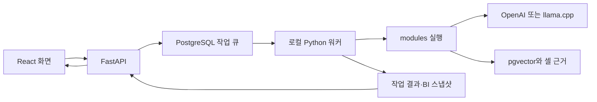

# 코드 구조와 수정 지점

API는 빠른 요청 등록·조회, 워커는 긴 Excel·RAG 작업을 담당합니다.
`run.py`가 API를, API가 네 종류의 로컬 워커를 시작합니다.

| 경로 | 책임·첫 파일 |
| --- | --- |
| `run.py` | 환경 설정, 로컬 DB·모델 시작/종료, API 실행 |
| `backend/entrypoints/` | ASGI·워커 진입점 |
| `backend/bootstrap/` | 의존성 조립, 스키마 초기화, 자원 수명 |
| `backend/domains/` | 적재·워크플로·채팅·BI·비교·벤치마크 규칙과 API |
| `backend/platform/` | PostgreSQL 풀, 모델 제공자, 공통 실행 기반 |
| `backend/shared/` | 도메인 간 계약·공통 표현 |
| `backend/api/`, `backend/core/` | 미들웨어·인증과 환경 설정 |
| `modules/` | reader·structure·embedding·retrieval·query·storage 개별 작업 |
| `jobs/` | 모듈을 연결한 표준 그래프 |
| `frontend/src/` | React 화면·API 클라이언트·스타일 |
| `dist/` | FastAPI가 제공하는 생성된 빌드; 직접 수정하지 않음 |
| `scripts/` | 설치·설정·점검·샘플 적재 |
| `examples/` | 공개 가상 데이터와 소형 예제 |
| `migrations/` | Alembic 변경 이력 |
| `tests/` | 계약·회귀·선택적 DB 통합 검사 |

## 흐름별 코드 읽기

Excel: `업로드 → source_files → jobs/excel_ingestion.py → reader → VLM 구조 분석 → 셀 직렬화 → 임베딩 → pgvector`.

질문: `챗봇 → workflow 큐 → jobs/rag_pipeline.py → 질문 분해 → 질의 임베딩 → 벡터·키워드 검색 → RRF → 문맥 확장 → 답변 → SSE/조회`.

일반 BI는 문서 기간 분석과 RAG 질문으로 관측값을 얻고 Decimal 계산기로 파생 지표를 만듭니다.
지표는 `backend/domains/bi/domain/catalog.py`, 계산은 `application/snapshot_builder.py`에서 시작합니다.
기업 비교는 발행된 BI 중 수치·셀 근거가 완전한 기업만 사용합니다.
`backend/bootstrap/sample_data.py`는 체크인된 샘플만 실제 셀에서 읽는 별도 실습 준비 도구입니다.

## 변경별 시작 지점

| 변경 | 파일 |
| --- | --- |
| 로컬 서비스 | `backend/bootstrap/local_services.py` |
| 제공자·모델 응답 변환 | `backend/platform/inference/` |
| 적재·검색 단계 | `jobs/` 연결과 `modules/` 구현 |
| BI 지표·공식 | `backend/domains/bi/domain/`, `application/` |
| 비교 점수 | `backend/domains/company_comparison/domain/league_scoring.py` |
| 화면 | `frontend/src/styles/`와 `features/*/*.css` |
| DB | 도메인 `infrastructure/postgres/`와 `migrations/` |

일부 도메인 루트 파일은 호환 import입니다. 실제 구현은 `application/`, `domain/`에 있습니다.
파이프라인 모듈을 backend 안에 중복 구현하지 말고 `modules/`의 기반 클래스를 사용합니다.
